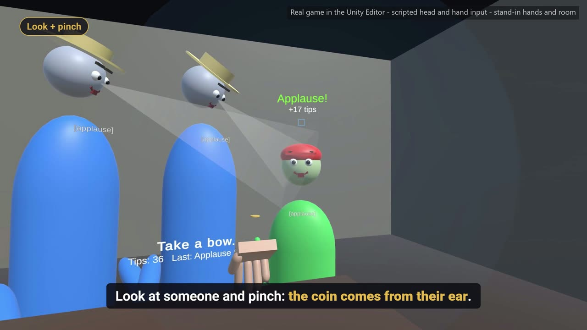
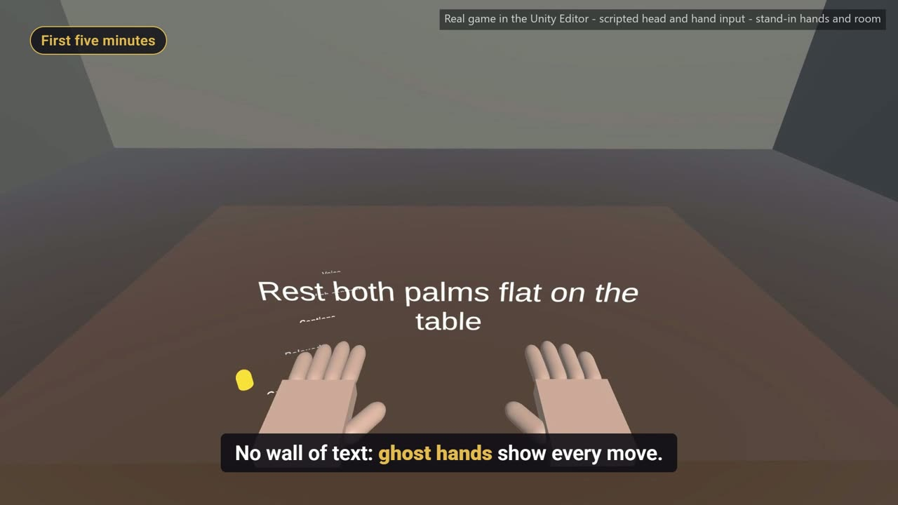
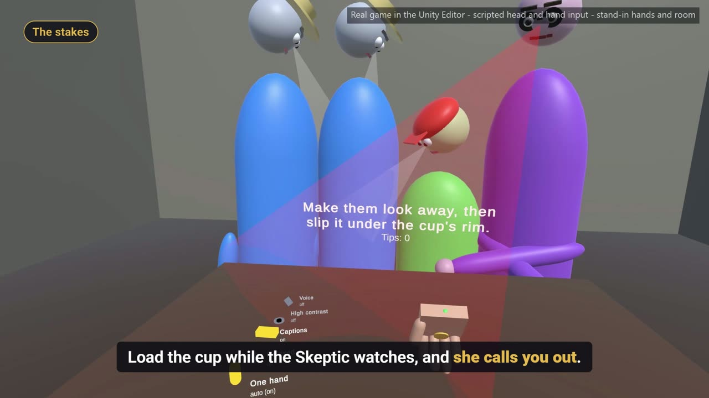

# Misdirection

**Street magic at your real table. Where you look, they look.**

A seated, hands-only, mixed-reality game for Meta Quest 3 and 3S. A small street crowd gathers across your own table, and their eyes follow yours. Look a spectator in the eye and they lock onto your face. Meanwhile your other hand palms, ditches and produces a coin at the table's edge. Get caught and the Skeptic points at your hands: "Hm!"

Entry for the **Meta VR Start Developer Competition 2026**, Gaming track, New Experience division.

| | |
|---|---|
| **Play it (Meta Quest 3 / 3S)** | [Competition release channel](https://www.meta.com/s/8hKddZFv8): open on your phone or PC, join, then install from your headset's library |
| **Video** | Demo video on YouTube (link on the Devpost page) |
| **Controllers** | Not needed. Hands only, start to finish |
| **Session** | A full show is three short acts; the first applause comes within the first minute |



## How to play

1. **Sit at a table** and launch the game. The room scan finds your table; if it can't, rest both palms flat on the table for a second (one palm works too).
2. **Follow the ghost hands.** On first launch one spectator, the Kid, teaches the rule with no text needed: pick up the coin, hold it up, look her in the eyes, drop the coin just past the near edge of the table, then show her your empty hand. She claps.
3. **Perform the show.** Three acts, and the crowd grows each act:
   - **Vanish and produce:** ditch the coin while they hold your gaze, then steal it back and look at someone and pinch near their ear to produce it.
   - **Coin under the cup:** slip it under the cup's rim and lift the cup for the reveal.
   - Clean methods earn applause and tips. Three busts and the crowd walks off.
4. **Take your bow** for tips and up to three stars. Pick the coin up again to start a new show.

Take both hands out of view and the show pauses ("the crowd waits"); bring them back and it carries on.



## What we built for each judging criterion

**Innovation & Creativity.** Gaze isn't a menu pointer here; it's the core verb. Each spectator blends where you look, your flourishes and any sounds into their attention, and a move made inside someone's attention cone raises their suspicion. Tourists follow your gaze, the Kid chases movement, the Skeptic watches your hands, the Filmer keeps a phone on the table. Stare too long and they look away, often at your hands.

**Experience Design.**
- **First five minutes:** a tutorial taught entirely by ghost hands and one spectator, with first applause in about 9 seconds of play.
- **Purposeful passthrough:** your real table is the stage, and the crowd stands on your open floor, clear of walls and furniture.
- **A reason to come back:** a new crowd and challenge every day, a trick book with mastery stars, a streak, and a returning Regular who remembers how you fooled him yesterday.
- **Accessible by default:** one-handed play switches on by itself (one-palm table setup, one-hand pause and resume). Relaxed timing, captions for the crowd's sounds, high contrast, an Access Tray you can toggle just by looking at it for 1.5 seconds, and an optional "Look!" or clap instead of the flourish. The microphone is only requested if you turn that on.

**Technical Implementation.**
- **Hands:** our own grip rules for hand tracking. A sticky pinch with the coin held at the wrist, no release decisions while tracking is unsure, and hands that freeze, fade and blend back when tracking drops.
- **Gaze:** the Interaction SDK v207's `GazeInteractor` hovering a `GazeInteractable` on every spectator's face, driven by head direction on Quest 3/3S and eye gaze where the device has it.
- **Room:** scene understanding (MRUK) to find the table and place the crowd, and a spatial anchor to remember the table next session.
- **Performance and layout:** shared materials (46 draw calls in a full scene), dynamic foveation and 72 Hz on Quest. Essential UI eases back into a 70° × 66° view, the narrowest of Meta's devices.
- **Tests:** the game rules are engine-free C# covered by 225 unit tests.

**Polish & Presentation.** Readable stylised spectators with faces, arms and 3-D voices; reactions that play through the crowd (claps, gasps, a pointed "Hm!"); every state has a sound and a visual, because hands have no haptics.



## Built without a headset

Nobody on the team has a Quest. We built and tested with:
- **Meta XR Simulator 207**, with webcam hand tracking and synthetic rooms.
- **An automated simulator smoke test** after every change. It checks for errors, the table, the crowd, the show stage, draw cost and the glasses-sized view.
- **Unit tests** for every game rule.

The demo video shows the real game running in the Unity Editor with **scripted head and hand input**; stand-in hands and a simple room take the place of your own hands and passthrough. Every trick, reaction and pause in it ran through the game's real code (`Assets/Misdirection/Scripts/Runtime/Trailer/`).

Release builds are signed and pass Meta's upload validation and security checks.

## Tech

- Unity 6 (6000.0.66f2), Universal Render Pipeline
- Meta XR SDK v207 (Core, Interaction SDK, MR Utility Kit, Platform)
- Hands only; built for Quest 3 and 3S

## Repository

| Path | What it is |
|---|---|
| `Assets/Misdirection/Scripts/Core` | Game rules as engine-free C#: crowd attention, suspicion, tricks, the show, the tutorial, progress, accessibility, layout |
| `Assets/Misdirection/Scripts/Runtime` | Unity components: hands, look source, table and room, crowd, tricks, show director, ghost hands, access tray, trick book |
| `Assets/Misdirection/Scripts/Editor` | One-click project setup, the simulator smoke test, APK builds, trailer capture |
| `Assets/Misdirection/Scenes/Show.unity` | The game |
| `tools/` | Build, upload, compile-check and test scripts; C# rule tests in `tools/tests/csharp` |

### Build and test

```bash
python -m unittest discover -s tools/tests -t .   # every game rule (C#) plus the tool tests
tools/sim_smoke.sh                                # play Show.unity in Meta XR Simulator, write a report
tools/build_apk.sh                                # signed release APK (needs a keystore in secrets/)
```

Open the project with Unity 6000.0.66f2, then run **Misdirection → Setup → Run Project Bootstrap** once.

## Licence

MIT. See [LICENSE](LICENSE).
